<!-- one workflow, one script, no badge farm. the rest is git. -->

<div align="center">
  
</div>

<br />

I build backend systems that stay boring under load. Most of it is **Go** and **Rust** services, storage internals, and the tooling that keeps them observable — distributed systems by day, terminal ergonomics by night.

I optimize for clarity over cleverness and systems over shortcuts. When something is slow, I reach for a profile first, not another cache.

```ini
# ~/.andev0x
focus   = distributed systems · storage · developer infrastructure
stack   = go · rust · typescript · python
runtime = postgres · redis · docker · kubernetes
mode    = shipping
```

### telemetry



<sub>Rendered daily by one scheduled workflow — public runner, repo-scoped token, no third-party APIs. It costs <b>$0.00</b> and there is no key to rotate.</sub>

### in flight

- **reliability** — SLOs, tracing, and postmortems that end in a diff
- **performance** — measuring the hot path before reaching for another cache
- **infrastructure** — making the boring path the default path

### elsewhere

[portfolio](https://andev0x.github.io/resume/) · [writing](https://andev0x.vercel.app/) · [contact](https://anvndev.github.io/) · [mail](mailto:anvndev@gmail.com)

> simplicity over complexity · clarity over cleverness · systems over shortcuts
