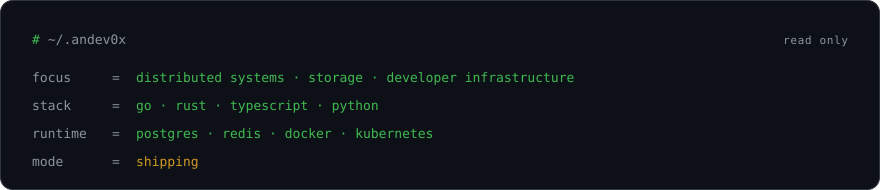
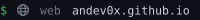
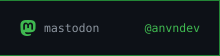
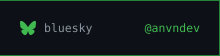

<!-- one workflow, one script, no badge farm. the rest is git. -->
<!-- palette: #0d1117 ground · #3fb950 signal · #d29922 shipping · #6e7681 quiet ink -->

I build backend systems that stay boring under load. Mostly **Go** and **Rust** — services, storage internals, and the tooling that keeps them observable. Distributed systems by day, terminal ergonomics by night.

I optimize for clarity over cleverness and systems over shortcuts. When something is slow, I profile first and cache last.

### telemetry

### in flight

- **reliability** — SLOs, tracing, and postmortems that end in a diff
- **performance** — measuring the hot path before reaching for another cache
- **infrastructure** — making the boring path the default path

### contact

<!-- borderless metadata row: 20px flat plate, no border, no card chrome -->

> simplicity over complexity · clarity over cleverness · systems over shortcuts
